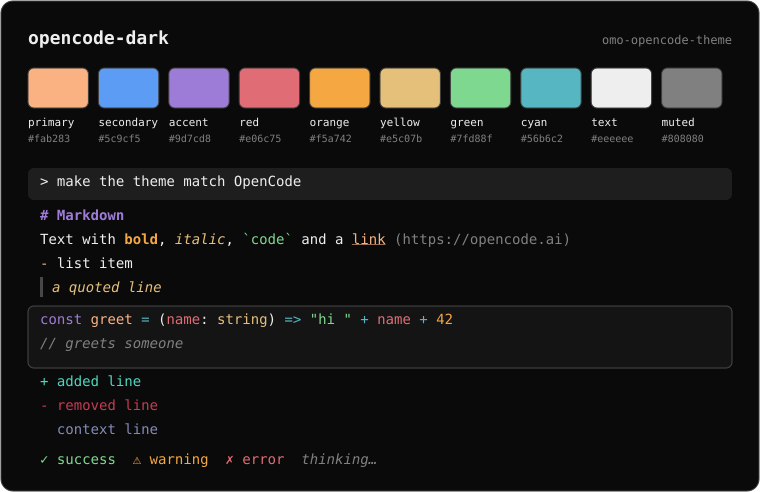
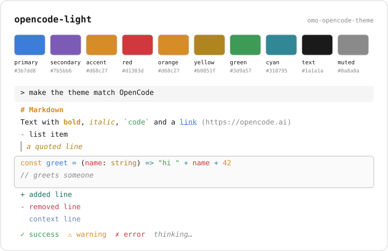

# omo-opencode-theme

[](https://www.npmjs.com/package/omo-opencode-theme)
[](LICENSE)

[OpenCode](https://github.com/sst/opencode)'s default dark and light themes, ported to [omo](https://github.com/code-yeongyu/senpi). Also works with senpi and pi, which share the same theme format.

If you're coming from OpenCode, your agent will look just like it did.

<p align="center">
  
</p>

<p align="center">
  
</p>

<sub>Previews are drawn from the theme files' own colors. Actual rendering depends on your terminal and font.</sub>

## Themes

| Theme | Appearance | Based on |
| --- | --- | --- |
| `opencode-dark` | dark | OpenCode `opencode` theme, dark variant |
| `opencode-light` | light | OpenCode `opencode` theme, light variant |

## Install

From npm:

```sh
omo install npm:omo-opencode-theme
```

Or from git:

```sh
omo install git:github.com/devxoul/omo-opencode-theme
```

Use `pi install` or `senpi install` instead if that's your CLI. Add `-l` to install into the current project's settings instead of your user settings.

To try it for one run without installing:

```sh
omo -e npm:omo-opencode-theme --use-theme opencode-dark
```

## Usage

Pick the theme in `/settings`, or set it in `~/.omo/agent/settings.json`:

```json
{
  "theme": "opencode-dark"
}
```

Switch to `opencode-light` the same way.

## What maps to what

The palette follows OpenCode's `opencode` theme. Where an omo token has an OpenCode counterpart, it uses the same color:

| omo token | OpenCode token | Dark | Light |
| --- | --- | --- | --- |
| `accent`, `borderAccent`, `mdLink` | `primary`, `markdownLink` | `#fab283` | `#3b7dd8` |
| `mdHeading`, `syntaxKeyword` | `markdownHeading`, `syntaxKeyword` | `#9d7cd8` | `#d68c27` |
| `mdBold` | `markdownStrong` | `#f5a742` | `#d68c27` |
| `mdItalic` | `markdownEmph` | `#e5c07b` | `#b0851f` |
| `mdCode`, `syntaxString`, `success` | `markdownCode`, `syntaxString`, `success` | `#7fd88f` | `#3d9a57` |
| `mdQuote`, `syntaxType` | `markdownBlockQuote`, `syntaxType` | `#e5c07b` | `#b0851f` |
| `error`, `syntaxVariable` | `error`, `syntaxVariable` | `#e06c75` | `#d1383d` |
| `warning`, `syntaxNumber` | `warning`, `syntaxNumber` | `#f5a742` | `#d68c27` |
| `syntaxOperator`, `bashMode` | `syntaxOperator` | `#56b6c2` | `#318795` |
| `text` | `text` | `#eeeeee` | `#1a1a1a` |
| `muted`, `syntaxComment` | `textMuted`, `syntaxComment` | `#808080` | `#8a8a8a` |

Backgrounds and borders use OpenCode's neutral step scale (`step1` to `step8`).

## Compatibility

`mdBold` and `mdItalic` are optional theme tokens added in recent omo/senpi releases (tested with `2026.10.30-1`). On older builds that don't support them, update omo first if the theme fails to load.

## Customizing

Copy a theme into your own themes directory and edit it:

```sh
mkdir -p ~/.omo/agent/themes
curl -fsSL https://raw.githubusercontent.com/devxoul/omo-opencode-theme/main/themes/opencode-dark.json \
  -o ~/.omo/agent/themes/my-theme.json
```

Change `"name"` in the copy to `my-theme`, adjust the `vars` palette, then select `my-theme`. Every color in `colors` points at a `vars` key or a hex value. See omo's theme docs for the full token list.

## Contributing

Issues and PRs are welcome. When a token has an OpenCode counterpart, keep it on the same palette color as OpenCode's [`opencode.json`](https://github.com/sst/opencode/blob/dev/packages/tui/src/theme/assets/opencode.json).

## License

[MIT](LICENSE). The color palette comes from OpenCode's theme, which is also MIT-licensed.
